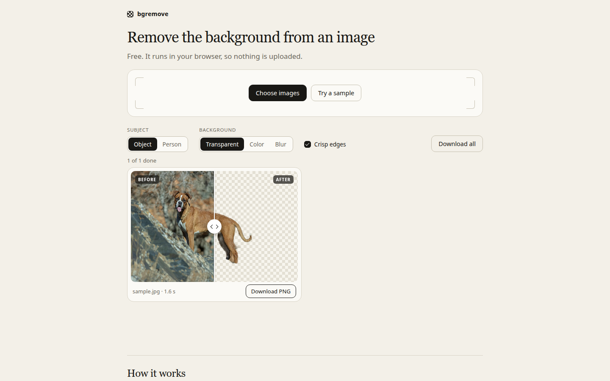

# bgremove

Remove the background from a photo without uploading it. Everything runs in the browser, so the image never leaves your device, and it keeps working offline after the first visit.

Live: https://davdd1.github.io/bgremove/

## Run it

    python3 -m http.server 8000 --bind 127.0.0.1

Open http://127.0.0.1:8000. Tests: `node --test tests/lib.test.mjs`.

## What is in here

- Photos go through ISNet general-use (DIS, Apache-2.0; ONNX conversion `imgly/isnet-general-onnx`, MIT). The weights are not in the repo (GitHub Pages files must stay under 100 MB): they are fetched from huggingface.co the first time and kept in the browser Cache API (`bgremove-models`). WebGPU runs the fp32 file (176 MB), WASM the fp16 file (88 MB).
- Logos and screenshots with a plain or smoothly shaded border are cut by color (`colorKey` in `lib.mjs`): a plane is fitted to the border pixels, pixels close to it become transparent with a soft edge, and edge colors are unmixed from the background. Auto mode picks this when the border is flat and noise-free (`isFlat`).
- `models/`: U2-Netp (Quick mode, offline) and MODNet (Person mode), both Apache-2.0. RMBG is left out on purpose, its license is non-commercial. BiRefNet lite (MIT) was tested and rejected, see `docs/models.md`.
- `vendor/`: ONNX Runtime Web 1.22.0 WebGPU bundle (MIT) and Motion 12.23.12 (MIT, used for the animations; skipped when reduced motion is on).
- `samples/dog.jpg`: CC0, "Boxer (dog), Iran 08.jpg" by Mostafa Meraji, Wikimedia Commons. `samples/logo.png`: made for this page.
- `sw.js`: caches everything local for offline use. Bump `CACHE` when you change a file.
